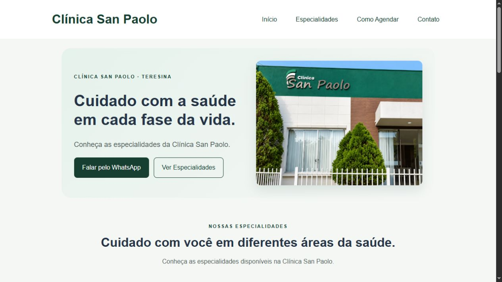
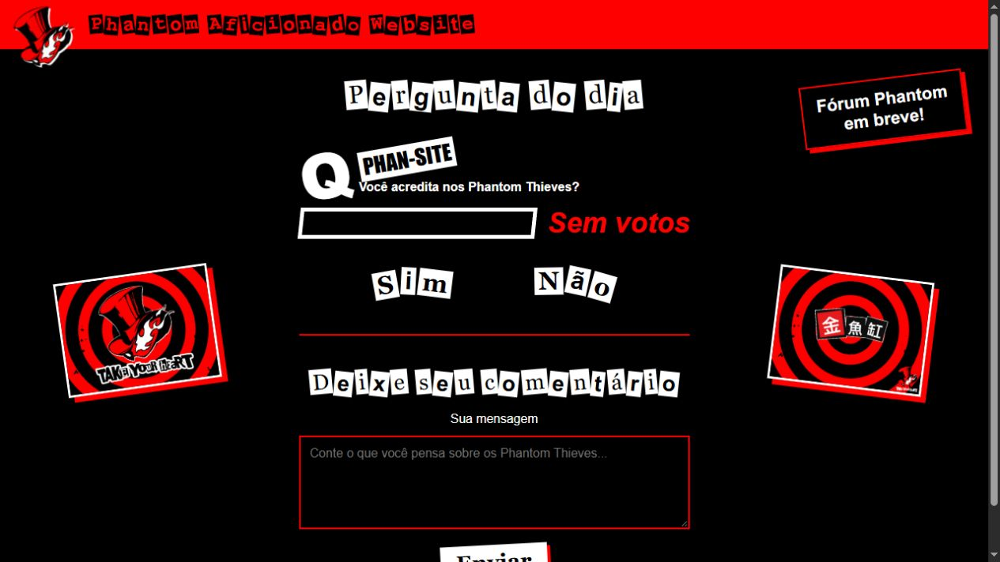

# Pedro

**Python & desenvolvimento web**

[Contato por e-mail](mailto:jpvasconcelos.0502@gmail.com) · Teresina, Brasil

### / sobre mim

Sou Pedro, desenvolvedor em formação. Estudo **Python, HTML, CSS e JavaScript** e aplico o que aprendo em programas de terminal e projetos web.

Tenho interesse em oportunidades iniciais, colaborações e pequenos projetos compatíveis com minhas habilidades.

### / projetos web

<table>
<tr>
<td width="50%" valign="top">

<h3>Clínica San Paolo</h3>

Site institucional com especialidades, localização e contato para agendamento.

<strong>HTML · CSS</strong>

<a href="https://pedrolvzz.github.io/clinica-san-paolo/">Ver projeto ↗</a> · <a href="https://github.com/Pedrolvzz/clinica-san-paolo">Código</a>

</td>
<td width="50%" valign="top">

<h3>Phansite</h3>

Site de fã inspirado em Persona 5, com votação, comentários e armazenamento local.

<strong>HTML · CSS · JavaScript</strong>

<a href="https://pedrolvzz.github.io/phansite/">Ver projeto ↗</a> · <a href="https://github.com/Pedrolvzz/phansite">Código</a>

</td>
</tr>
</table>

### / projetos em Python

| Projeto | O que estou praticando |
| :--- | :--- |
| [Reserva de Quartos](https://github.com/Pedrolvzz/reserva-de-quartos) | Disponibilidade, reservas e cancelamentos com listas e tratamento de entradas. |
| [Validador de Cadastro](https://github.com/Pedrolvzz/validador-cadastro) | Regras básicas de e-mail e cálculo de dígitos de CPF em um projeto de estudo. |

### / atualmente

- Aprofundando lógica de programação e organização de código.
- Praticando interfaces e interações para a web.
- Melhorando a documentação e o tratamento de erros dos projetos.

### / contato

[**jpvasconcelos.0502@gmail.com**](mailto:jpvasconcelos.0502@gmail.com)
